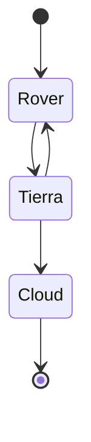

## 1. Estructura (Oscar)

- Se propone un rover **"arácnido"**.
- Se propone usar un **tornillo central** en lugar de un brazo de siembra con eje hueco, para hacer el hueco y sembrar en una sola operación.
- **Dudas abiertas:** material y tipo de llantas necesarios para tener suficiente tracción.

![[Pasted image 20261105092726.png]]

---

## 2. Visión (Daniel)

- Ya se presentó el proyecto a **Hernán**.
- Se propone empezar con **Q-learning** y luego migrar a **Deep Q-learning**.
- **Hardware propuesto:** una cámara del laboratorio de industrial o un **Kinect 1**.
- Se presentó una **simulación en Webots** con un escenario de **3 obstáculos**, obteniendo profundidad con Python (ver imagen).

![[Pasted image 20261105093102.png]]

- **Artículo usado por Daniel:** https://www.mdpi.com/2076-0825/13/1/26
- Se propone usar la **Jetson Nano** como punto de partida; si no se requiere tanto cómputo, se puede bajar a un modelo más básico.

---

## 3. Comunicaciones (Carlos)

![[Pasted image 20261105093549.png]]
![[Pasted image 20261105093611.png]]

- **Hay conflicto entre Walter y Carlos xD**
- Carlos propone unos **dashboards** que reciben cualquier tipo de CSV.
- Propone una **Raspberry Pi 4 de 2GB**, pero bajo los parámetros de MQTT sería insuficiente (falso).
- **Sigue habiendo conflicto xD**
- Propone usar un **broker externo** para usar MQTT con Arduino (wakala).
- **Cristian** propone usar las comunicaciones directamente en la **Jetson**.
- **Walter** dice que hay **Jetson limitadas** en el laboratorio; Cristian propone conseguir una en industrial.
- **Falta aclarar:** si la comunicación debe ser directa a la estación o por un punto intermedio.

- Se propone usar los **LoRa de Dianita <3**

---

## 4. Dashboard (Walter)

![[Pasted image 20261105095251.png]]

- Walter propone un **dashboard anterior**.
- Se propone trabajar con **Lu** en toda la parte de sensores: adquisición, formateo de datos y transmisión LoRa.

![[Pasted image 20261105095452.png]]

### Modos de exploración por zona
- **A.** Exploración
- **B.** Revisión
- **C.** Sin datos

- Se plantea generar una **matriz por zona** para indicar el lugar de siembra.

### Modo manual

![[Pasted image 20261105095736.png]]

### Modo retorno a base
- Generar una **ruta de retorno** basada en la ruta previa.

### En resumen
Una **matriz por zonas** para indicar dónde sembrar según lo que indique el juez.

---

## 5. Volando (lindo, pero fuera del scope)

- Generar un **mapa de la zona** y verificar datos por sector para informar al granjero.

![[Pasted image 20261105100135.png]]

- **Seguimiento de cultivo.**

---

## 6. Navegación (propuesta)

- **No usar distancia euclidiana**, sino **Manhattan**.

---

## 7. Dudas

- ¿Hay un **punto definido para siembra**?
- ¿O se deben cumplir ciertas **condiciones de sensado** para ir sembrando? (evaluar condiciones de la tierra maximizando el uso de la misma)

---

## 8. Percepción (Luisa)

- Creó la **carpeta en Drive** con una propuesta de sensores.

- **Video propuesto por Walter y Oscar:** https://www.youtube.com/watch?v=QItbAriB1Y0

### Requisitos clave del sensor de pH (resumen del video)

Para que el sensor de pH funcione correctamente no basta con insertarlo; el sistema requiere **calibración y preparación previa** para garantizar mediciones precisas:

- **Calibración del transmisor** ([4:13](https://www.youtube.com/watch?t=253s) – [4:46](https://www.youtube.com/watch?t=286s)): antes de usarlo por primera vez, alimentar el módulo con 5V y hacer un cortocircuito temporal en el conector _BNC_. Con un multímetro, ajustar el potenciómetro de calibración hasta que la salida marque exactamente **2.5V**, lo que corresponde a pH neutro (pH 7).
- **Compensación de temperatura** ([3:04](https://www.youtube.com/watch?t=184s) – [3:17](https://www.youtube.com/watch?t=197s)): la respuesta del electrodo varía con el calor. El módulo cuenta con un sensor de compensación de temperatura para corregir las mediciones; se recomienda colocarlo junto a la sonda de pH en el mismo recipiente ([14:46](https://www.youtube.com/watch?t=886s) – [15:02](https://www.youtube.com/watch?t=902s)).
- **Adaptación industrial** ([5:26](https://www.youtube.com/watch?t=326s) – [5:54](https://www.youtube.com/watch?t=354s)): en entorno real o para largas distancias, la señal analógica (0–5V) es muy sensible al ruido eléctrico. El autor recomienda migrar a un **protocolo robusto como RS485** ([7:50](https://www.youtube.com/watch?t=470s) – [8:12](https://www.youtube.com/watch?t=492s)), lo que requiere una tarjeta adicional con microcontrolador y conversor de señal.
- **Procesamiento de lectura** ([11:00](https://www.youtube.com/watch?t=660s) – [11:14](https://www.youtube.com/watch?t=674s)): en el código no es recomendable tomar la lectura bruta; el autor aplica un **filtro de suavizado** para evitar cambios bruscos en la medición.
- **Estabilización** ([11:16](https://www.youtube.com/watch?t=676s) – [11:27](https://www.youtube.com/watch?t=687s)): el electrodo no entrega un valor instantáneo. Esperar aproximadamente **2 minutos** sumergido en la solución para que la lectura se estabilice y sea confiable.

**En resumen:** aunque el electrodo se inserta en el líquido, el sistema electrónico requiere estar calibrado, compensado por temperatura y preferiblemente filtrado por software para ser útil en un invernadero.