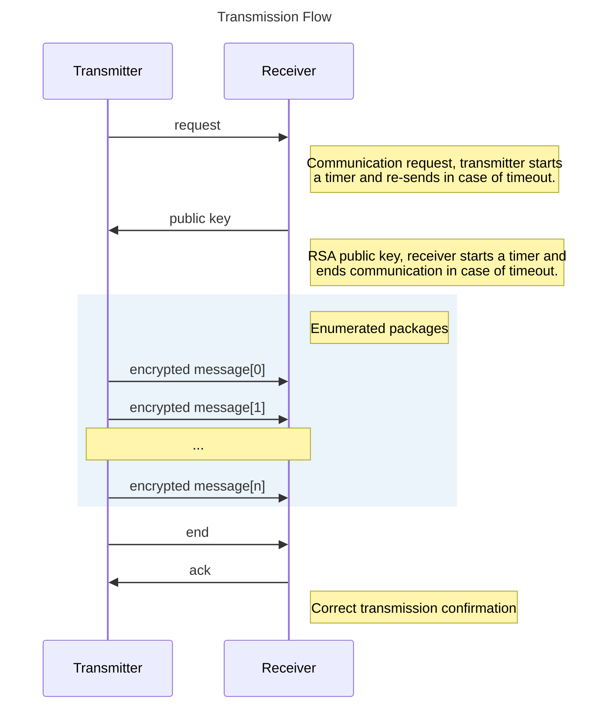
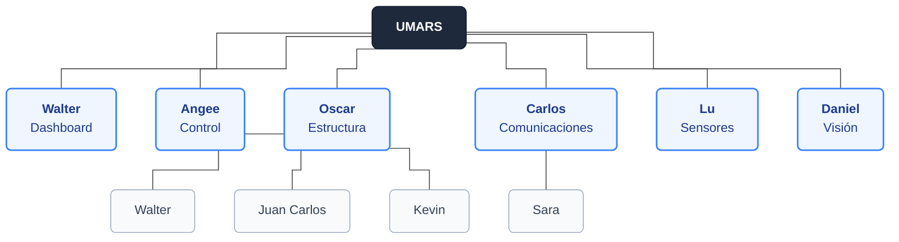

## 1. Novedades Generales
* **Nuevos integrantes:**
  * **Sara Galván** (Ing. de Sistemas) se incorpora al equipo para apoyar a Carlos en el área de **Comunicaciones**.
  * **Juan Pérez** (Ing. Mecánica) se incorpora al equipo para apoyar a Oscar en el área de **Estructura**.
* **Inscripción:** **Daniel Usme** presentó una propuesta de *abstract* para el documento de inscripción del proyecto.

---

## 2. Avances y Discusiones por Área

### Estructura
* **Eficiencia:** Juan propone utilizar únicamente **4 motores** en lugar de tracción en todas las ruedas, dejando las ruedas centrales solo como pivote con el objetivo de mejorar la eficiencia energética del rover.

### Sensores
* **Selección de componentes:** Walter comentó que estuvo evaluando distintas opciones de sensores en conjunto con Lu.

### Comunicaciones
* **Protocolo y manejo de errores:** Carlos presentó una propuesta de protocolo de comunicación con la estación en tierra que contempla cifrado con llave pública (RSA), envío de paquetes enumerados y control de *timeouts* para gestionar pérdidas de conexión:

* **Disponibilidad de hardware (Antena):** No fue posible conseguir la antena a través de I+D; el tiempo estimado de espera es de **6 semanas**.
  * *Alternativa temporal:* Walter propuso utilizar los módulos **LoRa de Diana** mientras llega la antena definitiva para no detener el desarrollo.
* **Formato de datos en tierra:** Ante la consulta de Walter sobre la estructura de datos requerida para la estación en tierra, Carlos confirmó que puede enviarse en **texto plano**, ya que él se encargará de procesarlo y ordenarlo según sea necesario.

---

## 3. Estructura Actual del Equipo

