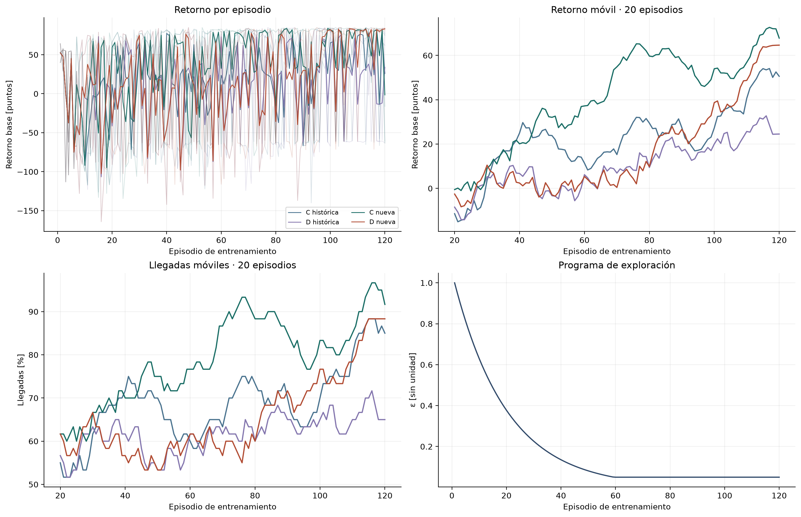
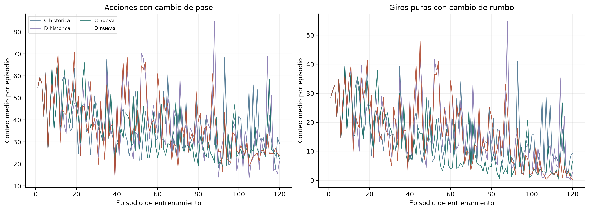
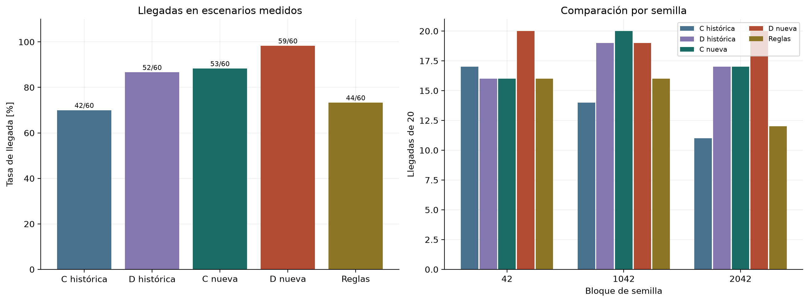
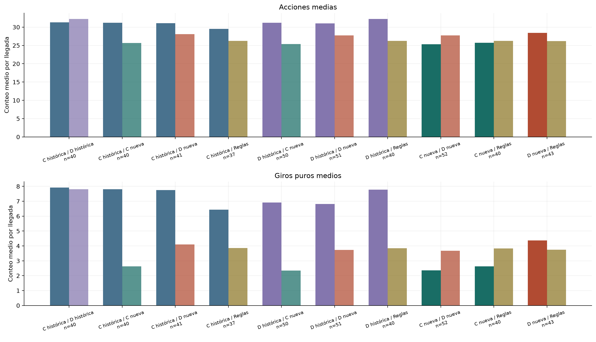
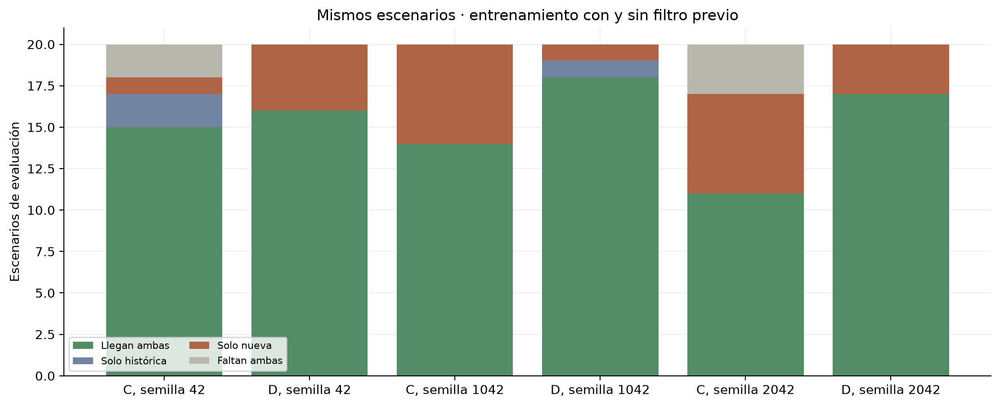
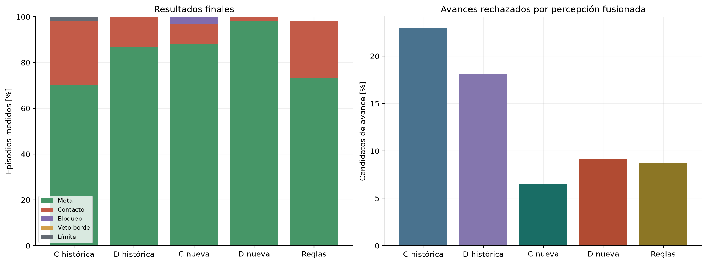
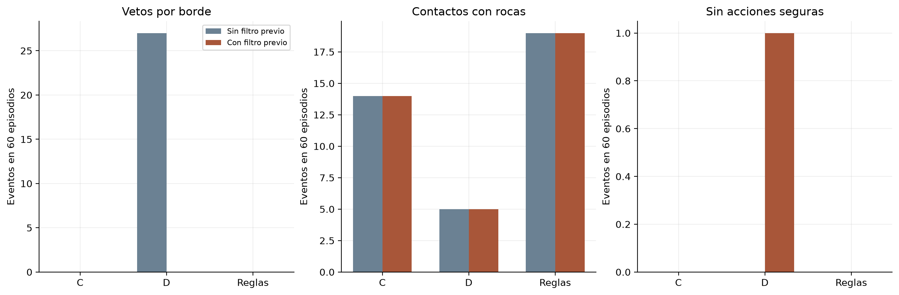
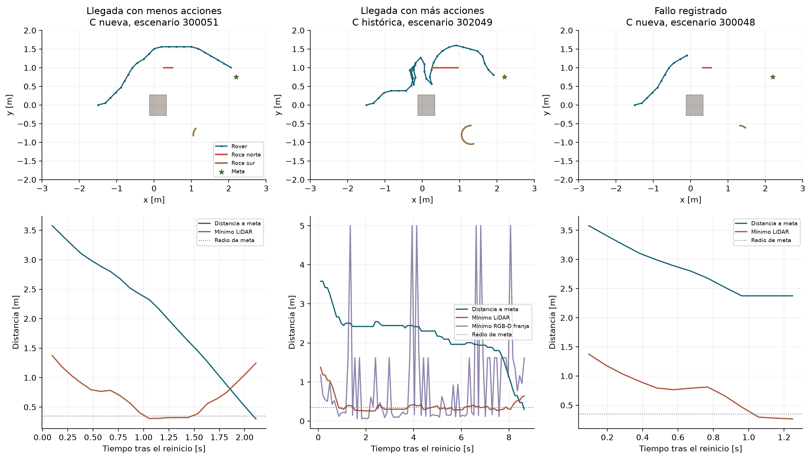
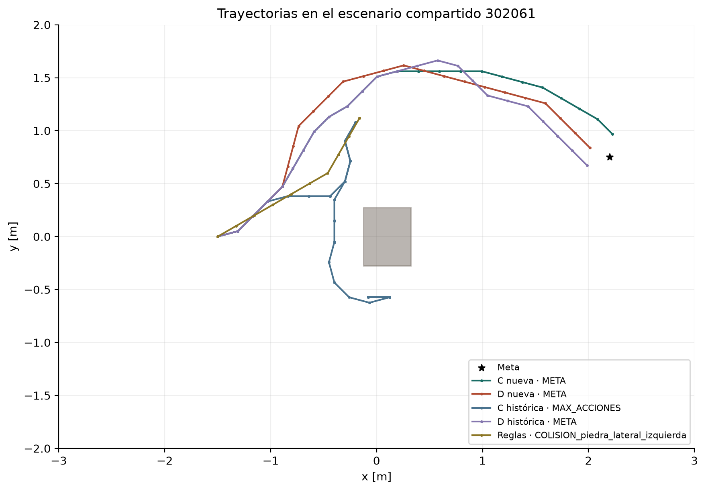
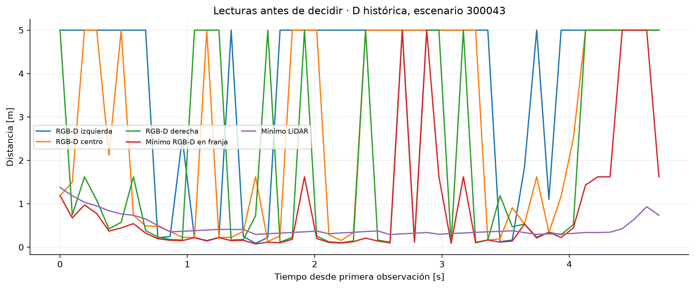

# UMARS–MALER · Informe preliminar de avances y validación experimental v8

**Alcance.** Navegación autónoma en Webots, con evidencia separada del desarrollo histórico, de la validación del filtro de borde con tablas congeladas y del estudio del filtro durante el aprendizaje. La comparación final incluyó las cinco políticas en 60 escenarios compartidos por política, para un total de 300 episodios de evaluación.

[Diccionario de datos](diccionario_datos.md) · [Configuraciones](configuraciones.md) · [Reproducibilidad](reproducibilidad.md) · [Datos por episodio](datos/episodios.csv) · [Trazas por paso](datos/transiciones.csv)

## 1. Introducción

UMARS–MALER estudia cómo llevar un rover desde una pose inicial conocida hasta una meta en un terreno marciano simplificado con obstáculos. La pregunta experimental es cómo cambia la navegación al combinar percepción de profundidad, Q-learning tabular, una penalización por giros evitables y filtros de seguridad. Se comparan un agente Q sin penalización (C), uno con penalización (D) y una política por reglas. C y D tienen versiones históricas y nuevas, entrenadas respectivamente sin y con el filtro previo de borde.

El avance de la v8 consiste en incorporar rocas móviles y separar el diagnóstico de navegación de la seguridad geométrica. Es posible estudiar por separado si un agente alcanza la meta, si propone una trayectoria que habría cruzado el borde y cuánto movimiento utiliza en los mismos escenarios que otra política también completa.

## 2. Arquitectura general

| Capa | Entrada y salida |
|---|---|
| Sensores | RangeFinder frontal entrega profundidad axial y LiDAR entrega una nube. La cámara RGB habilitada proporciona visualización. |
| Percepción | Reduce la profundidad a tres sectores, proyecta lecturas al plano local y determina cuáles de los tres avances pasan la comprobación con cada sensor. |
| Estado y políticas | Combina ocupación, dirección de la meta, lado de rodeo y clase de distancia. Selecciona una acción mediante Q-learning tabular o reglas. |
| Selección segura | Parte de la percepción, el error angular y el antibucle. El filtro previo de borde intersecta la lista resultante con acciones que conservan el chasis dentro del terreno. |
| Validación temporal | Comprueba el chasis y las rocas a lo largo de la acción. Si se autoriza, el Supervisor actualiza la pose en tres subpasos. |
| Evaluación y registro | Calcula distancia, recompensa y terminación. Guarda episodios y transiciones. Las actualizaciones Q ocurren solo en entrenamiento. |

La posición y orientación del rover y las coordenadas de la meta están disponibles mediante el Supervisor. Las posiciones exactas de las rocas se usan en la validación temporal y se guardan para diagnóstico. La política recibe observaciones y listas de acciones admisibles, mientras que el validador usa la geometría de la escena. [Controlador v8](../../controllers/umars_v8/umars_v8.py) · [Percepción](../../controllers/umars_qlearning/percepcion.py)

## 3. Entorno Webots

Webots R2025a simula un terreno de **6 × 4 m**, con límites en el plano $[-3,3]\times[-2,2]$ m. El rover parte de $(-1.5,0)$ m, rumbo $0$ rad, a una altura de 0,15 m. La meta está en $(2.2,0.75)$ m, con radio de aceptación de 0,35 m. El radio geométrico del chasis es 0,25 m. El paso de Webots es de 32 ms y cada acción consume tres subpasos, 96 ms de simulación. El reinicio inicial dura tres subpasos y queda fuera del tiempo de navegación por episodio.

| Elemento | Configuración de referencia |
|---|---|
| Roca central | Centro $(0.1,0)$ m, huella $0.45\times0.55$ m, fija. |
| Roca norte | Centro nominal $(0.6,1.0)$ m, huella $0.38\times0.48$ m, oscilación horizontal de amplitud 0,35 m. |
| Roca sur | Centro nominal $(1.3,-0.8)$ m, huella $0.60\times0.50$ m, trayectoria con amplitudes de 0,25 m en ambos ejes. |
| Cámara RGB | 320 × 240 píxeles, campo horizontal de 2,1 rad. |
| RangeFinder | 160 × 120 píxeles, campo horizontal de 2,1 rad, rango nominal de 0,05 a 5 m. |
| LiDAR | Una capa, 181 muestras horizontales, 270°, rango nominal de 0,05 a 5 m. |

Con $t$ en segundos y fases fijas por episodio, las trayectorias nominales son

$$
x_N(t)=0.6+0.35\sin(\omega_N t+\phi_N),\qquad y_N(t)=1.0,
$$

$$
x_S(t)=1.3+0.25\cos(\omega_S t+\phi_S),\qquad
y_S(t)=-0.8+0.25\sin(\omega_S t+\phi_S).
$$

Los pares $(\omega_N,\omega_S)$ alternan entre $(0.42,0.34)$ y $(0.60,0.48)$ rad/s en entrenamiento, y entre $(0.50,0.40)$ y $(0.68,0.55)$ rad/s en evaluación. Cada fase se obtiene de un generador reproducible por escenario. Las corridas de validación restablecen los centros nominales para evitar que una pose guardada desde la interfaz altere las condiciones. [Mundo dinámico](../../worlds/marte_v8_dinamico.wbt) · [Geometría y escenarios](../../controllers/umars_v8/control_v8.py)

## 4. Fundamentos matemáticos

### Percepción y estado

Se analiza la franja entre el 38 % y el 58 % de la altura de la imagen de profundidad. Los sectores horizontales izquierda, centro y derecha cubren respectivamente el 0–40 %, 30–70 % y 60–100 % del ancho. Se usa el percentil 20 y el umbral de ocupación de 1,50 m. Los retornos positivos infinitos se sustituyen por 5 m. Si faltan suficientes lecturas, el sector se marca desconocido. Para una profundidad axial $z$ en la columna $u$ y ancho $W$,

$$
x_{\rm local}=0.19+z,\qquad
y_{\rm local}=\left(1-\frac{2(u+0.5)}{W}\right)z\tan(2.1/2).
$$

Cada sensor contrasta puntos con un barrido del chasis con radio de seguridad de 0,27 m. Un avance está marcado como seguro cuando ambos sensores lo aceptan. La ocupación produce $b\in\{0,\dots,7\}$ contando ocupado y desconocido como uno. La dirección a la meta es $d\in\{-1,0,1\}$, según el error angular envuelto a $[-\pi,\pi)$ y un umbral de $\pi/6$. El lado de rodeo es $\ell\in\{0,1,2\}$ y $z_c$ indica distancia menor de 2,5 m. La codificación es

$$
s=2\{3[3b+(d+1)]+\ell\}+z_c,\qquad s\in\{0,\dots,143\}.
$$

La tabla contiene $144\times5=720$ valores. El ángulo exacto, la velocidad y fase de las rocas y la memoria interna del antibucle no forman parte de ese índice.

### Acciones, movimiento y seguridad

Las cinco acciones en orden de tabla son `AVANZAR`, `GIRAR_IZQUIERDA`, `GIRAR_DERECHA`, `AVANZAR_IZQUIERDA` y `AVANZAR_DERECHA`. Una acción de avance recorre $L=0.20$ m nominales. Un giro puro cambia solo $\theta$ en $\pm\pi/6$. Para una fracción $f\in[0,1]$ del avance recto, $p(f)=p_0+fL(\cos\theta_0,\sin\theta_0)$. Para un arco con cambio total $\Delta=\pm\pi/6$ y $R=L/\Delta$,

$$
\theta(f)=\theta_0+f\Delta,\quad
x(f)=x_0+R[\sin\theta(f)-\sin\theta_0],\quad
y(f)=y_0-R[\cos\theta(f)-\cos\theta_0].
$$

El filtro de borde exige $\lvert x(f)\rvert+0.25\leq3$ y $\lvert y(f)\rvert+0.25\leq2$ durante la acción. Para un arco se revisan extremos de cada coordenada, además de inicio y fin. El validador temporal contrasta conjuntamente la pose proyectada y las cajas móviles, con al menos 20 intervalos. La colisión geométrica se obtiene con la distancia del centro del rover al punto más cercano de cada rectángulo. Si la trayectoria se veta, el rover permanece quieto mientras las rocas avanzan los tres subpasos. Un contacto geométrico detectado entretanto puede prevalecer en la clasificación de la transición.

### Recompensa, exploración y actualización

Sea $D_t$ la distancia euclidiana a la meta antes de la acción. La recompensa base es

$$
r_t=-1+2(D_t-D_{t+1})+100\,\mathbf{1}_{\rm meta}-50\,\mathbf{1}_{\rm colisión}.
$$

El indicador de colisión incluye vetos terminales y motivos geométricos. La llegada se concede si no hay motivo de colisión y la pose cae en el radio de meta. D resta además 0,2 cuando la acción es un giro puro, existe algún avance marcado seguro por la percepción fusionada y la transición aún no es terminal por meta o colisión. Ese criterio se calcula antes del corte por límite de pasos. El registro conserva el retorno base y el usado para actualizar.

En entrenamiento, $\epsilon_e=\max(0.05,0.95^{e-1})$. Con probabilidad $\epsilon_e$ se escoge aleatoriamente entre los candidatos, y en el resto de los casos se elige el máximo Q admisible con desempate determinista por orden de lista. En evaluación se fija $\epsilon=0$. Si $A_{\rm ad}(s')$ es la lista admisible en la siguiente observación,

$$
Q(s,a)\leftarrow Q(s,a)+0.10\left[y-Q(s,a)\right],\qquad
y=\begin{cases} r,&\text{terminal o sin acciones futuras},\\
r+0.95\max_{a'\in A_{\rm ad}(s')}Q(s',a'),&\text{en otro caso}.
\end{cases}
$$

Las tablas nuevas incorporan el filtro de borde a la lista actual y a $A_{\rm ad}(s')$. La actualización conserva la recompensa observada cuando el siguiente paso carece de candidatos y prescinde del término futuro. [Agente tabular](../../controllers/umars_qlearning/agente_q.py) · [Recompensa y entorno](../../controllers/umars_qlearning/entorno.py) · [Watkins y Dayan, 1992](https://doi.org/10.1023/A:1022676722315)

## 5. Implementación

- `umars_v8.py` administra el Supervisor, el reinicio de escenarios, el reloj de simulación, el entrenamiento, la evaluación congelada y los registros.
- `control_v8.py` concentra el avance fraccionado, el cálculo de posiciones de las rocas y las comprobaciones de borde y colisión temporal.
- `agente_q.py` codifica el estado, gestiona el conjunto permitido y aplica Q-learning con memoria de rodeo y antibucle. El antibucle detecta giros alternados sin traslación y, cuando hay avances sensorialmente seguros, prioriza avanzar.
- `percepcion.py` calcula ocupación y seguridad a partir de RangeFinder y LiDAR. El panel LiDAR se limita a visualizar. `politica_reglas.py` orienta hacia la meta y elige un lado de rodeo con reglas deterministas. En la validación de borde por reglas se mantiene su decisión original cuando pasa la máscara.
- Los modos del estudio separan el rescate, el entrenamiento con máscara futura y la comparación de las tablas históricas. La modalidad de evaluación guarda identificadores de escenarios, configura carga congelada mediante SHA-256 y verifica los valores Q registrados contra la tabla correspondiente.

[Implementación del estudio](../../herramientas/estudiar_aprendizaje_borde_v8.py) · [Política por reglas](../../controllers/umars_qlearning/politica_reglas.py)

## 6. Evolución del proyecto

| Hito | Cambio y problema abordado | Dato histórico documentado |
|---|---|---|
| RGB-D estacionario | Adquisición y clasificación de profundidad como prueba de percepción. | Captura puntual de profundidad y RGB. |
| 24 estados, 3 acciones | Ocho patrones de ocupación por tres direcciones a la meta, avance y dos giros. | Meta cercana 10/10 en evaluación integrada. Meta lejana inicial 0/10. |
| v2 | Amplió campo visual y usó orientación hacia la meta. | 0/10 en evaluación integrada de meta lejana. |
| v3, 24 × 5 | Añadió avances curvos de ±30° para reducir maniobras en el sitio. | Q 0/10, reglas 10/10 en la configuración registrada. |
| v4, 144 × 5 | Agregó memoria de lado y dos clases de distancia. También se probó aumentar el horizonte de 60 a 120. | En entrenamiento, 2/60 y 4/60 llegadas respectivamente. |
| v5 | Proyección de profundidad y veto geométrico de trayectorias. | Q 0/10 en evaluación integrada. |
| v6 | LiDAR lateral para cubrir puntos ciegos. | Q 0/10 y reglas 10/10 en corridas registradas. |
| v7 | Filtro antibucle para romper alternancias de giro. | Q 44/60 en entrenamiento y 10/10 repeticiones de un escenario en evaluación. |
| v8 | Rocas móviles, coste de giro evitable, diagnóstico del borde y validación de la máscara con y sin aprendizaje. | Se separaron contactos, vetos, bloqueos y límites de pasos. |

Los registros pre-v8 cambian por versión en estado, acción, sensores, objetivos u horizonte. Sirven como historia de desarrollo. Algunas fuentes antiguas conservan solo transiciones parciales y el código de entrenamiento de todas las versiones no está archivado. [Consolidado pre-v8](datos/experimentos_pre_v8.csv) · [Diagnóstico histórico](../../DIAGNOSTICO_QLEARNING.md) · [Inventario v7](../../INFORME_UMARS_RGBD_PARA_GPT.md)

Los experimentos iniciales A y B de v8 se realizaron con terreno estático. A cargó la tabla v7 como referencia. B probó la penalización por giro en Q y una referencia por reglas. El piloto B con dos episodios de entrenamiento llegó en 0/2 evaluaciones. La corrida B con 60 episodios de entrenamiento llegó en 10/10 repeticiones de un mismo escenario, y las reglas obtuvieron 2/2 en su corrida corta. Después se incorporaron las rocas móviles en C y D. Los tamaños de entrenamiento y la diversidad de escenarios varían entre esas corridas. [Experimentos v8 iniciales](datos/experimentos_v8_iniciales.csv)

## 7. Metodología experimental

| Grupo | Entrenamiento | Evaluación en el estudio nuevo |
|---|---|---|
| C histórica | 120 episodios por semilla, sin filtro previo y sin coste de giro. | Tabla congelada, filtro previo, 20 escenarios por semilla. |
| D histórica | 120 episodios por semilla, sin filtro previo y coste de 0,2. | Tabla congelada, filtro previo, 20 escenarios por semilla. |
| C nueva | 120 episodios por semilla, Q en cero, filtro en decisión y objetivo Q, coste 0. | Captura de la tabla al acabar el entrenamiento, ε = 0. |
| D nueva | Mismo diseño que C nueva, coste 0,2. | Captura de la tabla al acabar el entrenamiento, ε = 0. |
| Reglas | Sin entrenamiento. | Mismas condiciones del mundo y escenarios. |

Semillas de entrenamiento **42, 1042 y 2042**. El identificador de entrenamiento es semilla más episodio. Las nuevas bases de evaluación son **200042, 201042 y 202042**, con identificadores de escenario iguales a la base más 100 000 más el episodio. Hay 20 escenarios por bloque. Dentro de cada bloque, se valida igualdad de semilla de escenario, velocidad angular y fase de ambas rocas, inicio y meta. El horizonte es de 120 acciones. Las políticas nuevas comparten escenarios de entrenamiento con su par y el mismo programa de exploración.

En la validación anterior se ejecutaron 18 corridas y 360 episodios, con filtro activo e inactivo y tablas congeladas. El estudio actual usa escenarios de evaluación nuevos. El rescate 102061 tiene salida independiente y está desactivado en las comparaciones. Los conteos de acciones distinguen las intentadas de las que cambiaron la pose. Un avance rechazado por percepción es un candidato y un veto geométrico es un resultado después de elegir. La eficiencia se calcula con los escenarios que ambos miembros de un par completaron. Se guarda además el conjunto de llegadas exclusivas de cada política. [Parámetros y archivos fuente](configuraciones.md) · [Eficiencia pareada](datos/eficiencia_pareada.csv) · [Llegadas exclusivas](datos/llegadas_exclusivas.csv)

## 8. Resultados experimentales

<!-- RESULTADOS_INICIO -->
**Evaluación en escenarios nuevos:** 15 de 15 corridas completas, 300 episodios observados; 0 corridas pendientes.

### Entrenamiento registrado

| Política | Semilla | Episodios | Metas | Vetos borde | Contactos | Bloqueos | Límites | Retorno base medio | Retorno Q medio |
|---|---|---|---|---|---|---|---|---|---|
| C histórica | 42 | 120 | 98 | 4 | 18 | 0 | 0 | 44,01 | 44,01 |
| C histórica | 1042 | 120 | 73 | 3 | 44 | 0 | 0 | 9,15 | 9,15 |
| C histórica | 2042 | 120 | 78 | 2 | 40 | 0 | 0 | 12,98 | 12,98 |
| D histórica | 42 | 120 | 77 | 3 | 38 | 0 | 2 | 14,41 | 12,96 |
| D histórica | 1042 | 120 | 61 | 17 | 41 | 0 | 1 | -8,39 | -10,04 |
| D histórica | 2042 | 120 | 84 | 8 | 28 | 0 | 0 | 23,20 | 21,93 |
| C nueva | 42 | 120 | 95 | 0 | 20 | 5 | 0 | 43,18 | 43,18 |
| C nueva | 1042 | 120 | 100 | 0 | 19 | 0 | 1 | 46,97 | 46,97 |
| C nueva | 2042 | 120 | 88 | 0 | 32 | 0 | 0 | 29,01 | 29,01 |
| D nueva | 42 | 120 | 82 | 0 | 36 | 0 | 2 | 21,29 | 19,90 |
| D nueva | 1042 | 120 | 67 | 0 | 51 | 0 | 2 | 1,65 | 0,22 |
| D nueva | 2042 | 120 | 94 | 0 | 25 | 1 | 0 | 36,27 | 35,00 |

### Evaluación por política y semilla

| Política | Semilla | Llegadas | Vetos borde | Contactos | Bloqueos | Límites | Acciones ejecutadas | Giros puros ejecutados | Distancia media (m) | Tiempo medio (s) | Retorno base medio |
|---|---|---|---|---|---|---|---|---|---|---|---|
| C histórica | 42 | 17/20 | 0 | 3 | 0 | 0 | 464 | 55 | 4,07 | 2,24 | 60,54 |
| C histórica | 1042 | 14/20 | 0 | 6 | 0 | 0 | 457 | 77 | 3,77 | 2,22 | 37,64 |
| C histórica | 2042 | 11/20 | 0 | 8 | 0 | 1 | 805 | 397 | 4,04 | 3,90 | -0,41 |
| D histórica | 42 | 16/20 | 0 | 4 | 0 | 0 | 608 | 202 | 4,03 | 2,94 | 45,58 |
| D histórica | 1042 | 19/20 | 0 | 1 | 0 | 0 | 634 | 133 | 4,97 | 3,05 | 67,50 |
| D histórica | 2042 | 17/20 | 0 | 3 | 0 | 0 | 476 | 48 | 4,24 | 2,30 | 59,95 |
| C nueva | 42 | 16/20 | 0 | 2 | 2 | 0 | 475 | 68 | 4,05 | 2,29 | 57,43 |
| C nueva | 1042 | 20/20 | 0 | 0 | 0 | 0 | 503 | 38 | 4,61 | 2,41 | 81,82 |
| C nueva | 2042 | 17/20 | 0 | 3 | 0 | 0 | 466 | 42 | 4,22 | 2,25 | 60,46 |
| D nueva | 42 | 20/20 | 0 | 0 | 0 | 0 | 488 | 26 | 4,58 | 2,34 | 82,61 |
| D nueva | 1042 | 19/20 | 0 | 1 | 0 | 0 | 685 | 181 | 4,99 | 3,29 | 64,98 |
| D nueva | 2042 | 20/20 | 0 | 0 | 0 | 0 | 481 | 17 | 4,59 | 2,31 | 82,99 |
| Reglas | 42 | 16/20 | 0 | 3 | 0 | 0 | 468 | 68 | 3,99 | 2,27 | 52,65 |
| Reglas | 1042 | 16/20 | 0 | 4 | 0 | 0 | 474 | 76 | 3,97 | 2,29 | 52,31 |
| Reglas | 2042 | 12/20 | 0 | 8 | 0 | 0 | 423 | 74 | 3,48 | 2,07 | 23,91 |

| Política | Semillas medidas | Llegadas observadas | Contactos | Bloqueos |
|---|---|---|---|---|
| C histórica | 3 | 42/60 | 17 | 0 |
| D histórica | 3 | 52/60 | 8 | 0 |
| C nueva | 3 | 53/60 | 5 | 2 |
| D nueva | 3 | 59/60 | 1 | 0 |
| Reglas | 3 | 44/60 | 15 | 0 |

### Eficiencia y llegadas exclusivas

| Primera política | Segunda política | Escenarios comparables | Llegadas compartidas | Acciones medias | Giros medios | Llegadas exclusivas |
|---|---|---|---|---|---|---|
| C histórica | D histórica | 60 | 40 | 31,32 / 32,23 | 7,92 / 7,80 | 2 / 12 |
| C histórica | C nueva | 60 | 40 | 31,18 / 25,65 | 7,80 / 2,62 | 2 / 13 |
| C histórica | D nueva | 60 | 41 | 31,10 / 28,07 | 7,76 / 4,10 | 1 / 18 |
| C histórica | Reglas | 60 | 37 | 29,51 / 26,24 | 6,43 / 3,86 | 5 / 7 |
| D histórica | C nueva | 60 | 50 | 31,18 / 25,36 | 6,92 / 2,34 | 2 / 3 |
| D histórica | D nueva | 60 | 51 | 31,00 / 27,75 | 6,82 / 3,73 | 1 / 8 |
| D histórica | Reglas | 60 | 40 | 32,25 / 26,23 | 7,78 / 3,85 | 12 / 4 |
| C nueva | D nueva | 60 | 52 | 25,35 / 27,71 | 2,37 / 3,67 | 1 / 7 |
| C nueva | Reglas | 60 | 40 | 25,73 / 26,23 | 2,62 / 3,83 | 13 / 4 |
| D nueva | Reglas | 60 | 43 | 28,42 / 26,16 | 4,37 / 3,74 | 16 / 1 |

Los promedios y las llegadas exclusivas siguen el orden primera / segunda. El CSV pareado incluye el desglose por semilla. Los totales de políticas con distinto número de escenarios no se usan para atribuir diferencias.

### Cobertura de sensores y casos seleccionados

Hay 65041 filas de transición exportadas y 4383 con mínimo RGB-D registrado, de 8 corridas. Las banderas fusionadas y el mínimo LiDAR se conservan de acuerdo con el CSV original.

| Caso | Política | Semilla de escenario | Resultado | Acciones | Giros | Distancia (m) | Tiempo (s) |
|---|---|---|---|---|---|---|---|
| Llegada con menos acciones | C nueva | 300051 | META | 22 | 0 | 4,38 | 2,11 |
| Llegada con más acciones | C histórica | 302049 | META | 90 | 55 | 6,94 | 8,64 |
| Fallo registrado | C nueva | 300048 | COLISION_piedra_lateral_izquierda | 13 | 3 | 1,99 | 1,25 |

[Evaluación consolidada](datos/consolidado_evaluacion.csv) · [Eficiencia por semilla](datos/eficiencia_pareada.csv) · [Casos pendientes](datos/pendientes.csv) · [Estados visitados](datos/estados_visitados.csv)
<!-- RESULTADOS_FIN -->

### Curvas de entrenamiento

Los trazos tenues son semillas individuales. Las líneas centrales muestran el promedio de las semillas disponibles por grupo; la media móvil usa 20 episodios consecutivos. Se usa el retorno base para que la penalización de D no introduzca por definición una diferencia en el eje. El panel ε muestra el programa de exploración verificado.

Cada punto compara la cantidad media de acciones o giros ejecutados en ese episodio entre los grupos. Un episodio que termina temprano puede consumir pocas acciones debido a un fallo. La eficiencia de evaluación se calcula aparte.

### Llegadas, eficiencia y seguridad

Las etiquetas indican numerador y denominador reales. Los huecos representan corridas pendientes. Las barras por semilla permiten separar resultados medidos en bloques equivalentes de totales obtenidos con distinto número de corridas.

Cada par tiene su propio conjunto y tamaño $n$. Se muestran acciones que cambiaron la pose y giros puros que cambiaron el rumbo. Las barras claras representan el segundo miembro de cada par.

Cada barra incluye todo un bloque comparable. Se distingue la llegada de ambas tablas, la exclusiva de cada una y el fallo de ambas. Así se identifica cuánto cambió la llegada tras entrenar con el filtro en el mismo conjunto de evaluación.

El panel izquierdo clasifica episodios completos. El derecho divide avances rechazados por tres veces el número de observaciones con las tres banderas sensoriales válidas. Un valor alto puede reflejar una trayectoria más próxima a obstáculos y señala candidatos descartados, no contactos.

Esta figura usa los 60 escenarios por política de la validación anterior. Aísla el efecto de activar el filtro previo con la tabla congelada. Su población de evaluación es distinta de la que se usa para comparar el efecto del entrenamiento con filtro.

### Navegación y casos reales

De izquierda a derecha se seleccionan la llegada con menos acciones, la llegada con más acciones y un fallo por contacto cuando existe. Las posiciones de rocas y del rover se registran después de la acción. LiDAR y RGB-D, donde está registrado, se leen antes de elegirla. El eje temporal identifica el intervalo de la transición. Las líneas conectan muestras por acción. El caso de más acciones ilustra el costo de la navegación observado en la muestra.

Se elige un escenario compartido con el mayor número de políticas disponibles y, en caso de empate, diversidad de resultados. Todas las trayectorias tienen el mismo origen y meta. [Selección y coordenadas de los casos](datos/casos_representativos.csv)

Las curvas RGB-D sectoriales muestran el percentil 20. La curva de franja muestra su mínimo axial procesado, y LiDAR muestra el mínimo horizontal. Son medidas de geometría y campo visual distintos. [Cobertura y resumen de lecturas](datos/cobertura_sensores.csv)

### Transiciones comprobables

| Corrida y paso | Estado | Acción | Recompensa base | Observación y resultado |
|---|---:|---|---:|---|
| C nueva 42, entrenamiento 1, paso 1 | 42 | `AVANZAR` | −0,608414 | Q inicial cero, LiDAR 1,375 m, rumbo 0, posición posterior $(-1.3,0)$ m. La distancia restante es 3,579455 m. |
| La misma corrida, paso 2 | 42 | `GIRAR_IZQUIERDA` | −1,000000 | Q del avance antes de seleccionar −0,0608414. LiDAR 1,175 m, giro posterior de $+\pi/6$, posición igual. |
| D histórica 2042, validación filtrada, escenario 102061, decisión 19 | 13 | — | — | Los tres avances admisibles por el antibucle cruzan el borde. Termina sin acciones seguras tras 18 acciones. |
| Rescate aislado 102061, paso 19 | 13 | `GIRAR_DERECHA` | −1,000000 | El giro se ejecuta. En el paso 20 avanza por la derecha y alcanza la meta en el paso 28. |

[CSV de transiciones](datos/transiciones.csv) · [Cambios Q reconstruidos](datos/cambios_q_entrenamiento.csv) · [Rescate aislado](datos/rescate_102061.csv)

## 9. Análisis de resultados

En la validación previa con tablas congeladas, activar el filtro de borde recuperó 26 de los 27 vetos de D y elevó las llegadas de 28/60 a 54/60. Se mantuvieron cinco contactos con rocas y no hubo agotamiento de pasos. El fallo restante se clasificó como ausencia de acciones seguras en 102061. En C y reglas, el cambio dejó las llegadas en 46/60 y 41/60 respectivamente. Eso aísla el efecto de **la selección previa** en ese conjunto de escenarios. [Validación previa](datos/validacion_borde_previa.csv)

En los 60 escenarios nuevos, las tablas reentrenadas con filtro dieron **53/60 en C nueva y 59/60 en D nueva**. Dentro de los pares C nueva y D nueva, D hizo menos giros en las semillas 42 y 2042. En 1042, C registró 20/20 frente a 19/20 de D y fue más eficiente en las llegadas compartidas. La penalización de 0,2 no produjo el mismo efecto en todas las semillas.

### Comparación en escenarios equivalentes

<!-- ANALISIS_INICIO -->
- **C histórica y C nueva.** En 60 escenarios pareados, llegaron 42 y 53 veces. Las llegadas exclusivas fueron 2 y 13. En las 40 llegadas compartidas, los promedios de acciones fueron 31,18 y 25,65, y los de giros puros 7,80 y 2,62.
- **D histórica y D nueva.** En 60 escenarios pareados, llegaron 52 y 59 veces. Las llegadas exclusivas fueron 1 y 8. En las 51 llegadas compartidas, los promedios de acciones fueron 31,00 y 27,75, y los de giros puros 6,82 y 3,73.
- **C nueva y D nueva.** En 60 escenarios pareados, llegaron 53 y 59 veces. Las llegadas exclusivas fueron 1 y 7. En las 52 llegadas compartidas, los promedios de acciones fueron 25,35 y 27,71, y los de giros puros 2,37 y 3,67.
- **C nueva y Reglas.** En 60 escenarios pareados, llegaron 53 y 44 veces. Las llegadas exclusivas fueron 13 y 4. En las 40 llegadas compartidas, los promedios de acciones fueron 25,73 y 26,23, y los de giros puros 2,62 y 3,83.
- **D nueva y Reglas.** En 60 escenarios pareados, llegaron 59 y 44 veces. Las llegadas exclusivas fueron 16 y 1. En las 43 llegadas compartidas, los promedios de acciones fueron 28,42 y 26,16, y los de giros puros 4,37 y 3,74.
<!-- ANALISIS_FIN -->

Un contacto con la roca móvil puede ocurrir mientras el rover está quieto durante un giro. Un veto de borde impide ejecutar la acción. El bloqueo del antibucle puede ocurrir aunque un giro aislado sea geométricamente seguro. Estos resultados describen mecanismos distintos y se separan en todas las tablas. Las eficiencias de pares distintos no son directamente comparables si cada par completó un conjunto distinto de escenarios.

La comparación histórica frente a nueva con el filtro de borde activo en ambos casos muestra una mejora neta de 11 llegadas para C y de 7 para D tras incorporar el filtro al entrenamiento. C pasó de 17 a 5 contactos, y D de 8 a 1. Las tablas nuevas también redujeron sus acciones y giros medios frente a su propia referencia histórica en las llegadas compartidas. Los escenarios y parámetros de entrenamiento se emparejaron por semilla. El filtro modifica las alternativas exploradas y el máximo Q futuro, de modo que la evidencia corresponde al efecto conjunto de esas dos intervenciones durante el aprendizaje. [Resultados por semilla](datos/consolidado_evaluacion.csv) · [Eficiencia pareada](datos/eficiencia_pareada.csv)

## 10. Problemas identificados y soluciones

| Problema | Intervención y evidencia |
|---|---|
| Giros repetitivos | El antibucle detecta alternancias y cambia el conjunto de acciones. En un caso el propio filtro dejó solo avances que el borde eliminó. |
| Limitaciones de percepción | La profundidad por sectores simplifica la observación. La nube LiDAR amplía cobertura y la fusión bloquea avances cuando cualquiera de los sensores indica riesgo. El borde del terreno se trata por geometría explícita. |
| Vetos por borde | La decisión excluye trayectorias que cruzan el límite antes del validador final. La validación congelada eliminó los 27 vetos registrados de D. |
| Penalización por giro | Busca reducir giros evitables. El indicador se basa en percepción y puede penalizar un giro que sea obligatorio tras otros filtros. Se conserva la regla original para comparar. |
| Escenario 102061 | Ambos giros eran seguros en el paso 19, pero solo el giro hacia rumbo 0 abría avances que respetaban el borde. Una prueba separada, con la misma tabla, llegó en 28 acciones y cinco giros sin contacto. |
| Filtro durante aprendizaje | Los candidatos se intersectan con el borde antes de elegir y también al formar el máximo Q futuro. El programa reproduce las tablas entrenadas desde los registros. |

[Diagnóstico del borde](../experimentos_v8/diagnostico_vetos_cd.md) · [Informe de aprendizaje y rescate](../aprendizaje_borde_v8/informe.md)

## 11. Limitaciones actuales

- Es una simulación con movimiento cinemático escrito por el Supervisor. Faltan un actuador de motores implementado, dinámica de ruedas, odometría y una validación en hardware.
- La orientación a la meta y el filtro derivan de una pose exacta en el simulador. El estado discretizado carece de velocidades relativas, fase de obstáculos y memoria completa de los filtros. El resultado de convergencia del Q-learning tabular establece condiciones que aquí no se han demostrado.
- Se probaron tres semillas, un terreno y una familia de trayectorias sinusoidales con la misma meta. Las fases cambian entre escenarios. Las comparaciones son descriptivas y no estiman significancia estadística.
- Los archivos de transición anteriores a la instrumentación adicional conservan el mínimo LiDAR y las banderas fusionadas de avance. Carecen de las distancias RGB-D por sector y de las nubes o imágenes completas sincronizadas. Las referencias posteriores con telemetría incluyen cuatro escalares RGB-D y máscaras por sensor, con campos vacíos donde sigue sin haber dato comparable. [Diccionario](diccionario_datos.md)
- La distancia recorrida usa el desplazamiento entre poses registradas de una acción. En arcos es la cuerda observada y no toda la longitud curvilínea ideal. Los contactos son predicados geométricos, sin fuerzas de impacto medidas. No hay implementación de SARSA ni DQN.

## 12. Próximas etapas

1. Ampliar semillas y distribuciones de movimiento con una partición de prueba fijada de antemano. Comparar éxito, contactos y eficiencia pareada.
2. Estudiar representaciones que incorporen velocidad relativa percibida y distancia al borde. Medir el efecto sin modificar simultáneamente percepción, recompensa y algoritmo.
3. Comparar Q-learning con SARSA y DQN bajo el mismo presupuesto y las mismas máscaras. Mantener la política por reglas como referencia.
4. Introducir actuadores de ruedas, odometría, ruido, latencia y márgenes calibrados en simulación. Después evaluar percepción y control en Jetson Nano y transferir al rover físico por etapas.

## 13. Conclusiones

- El filtro previo de borde recuperó 26 episodios medidos con tablas congeladas. El rescate 102061 demostró una recuperación puntual y se mantuvo aislado de la comparación principal.
- En los 60 escenarios nuevos, **D nueva registró la mayor cantidad de llegadas, 59/60, y el menor número de contactos, uno**. C nueva alcanzó 53/60 y reglas 44/60. Con el mismo filtro de evaluación, C histórica alcanzó 42/60 y D histórica 52/60.
- En las 52 llegadas compartidas de C nueva y D nueva, C usó menos acciones y giros en promedio. D completó siete escenarios en los que C falló, y C completó uno en el que D falló. El mejor desempeño de D en llegadas observadas coexistió con una eficiencia de movimiento que dependió de la semilla. Los datos no establecen que el coste de giro reduzca los giros con cualquier semilla.
- Se comprobaron las firmas SHA-256 de las seis tablas históricas y se reprodujeron exactamente las doce tablas históricas y nuevas a partir de los registros de actualización. Las inferencias siguen circunscritas a las tres semillas, el terreno y los movimientos medidos en Webots. [Datos consolidados](datos/consolidado_evaluacion.csv) · [Actualizaciones Q](datos/cambios_q_entrenamiento.csv)

## 14. Referencias

- Watkins, C. J. C. H. y Dayan, P. (1992). *Technical Note: Q-Learning*. Machine Learning, 8, 279–292. [Publicación](https://doi.org/10.1023/A:1022676722315)
- Cyberbotics. Webots R2025a. [Supervisor](https://github.com/cyberbotics/webots/blob/R2025a/docs/reference/supervisor.md) · [RangeFinder](https://github.com/cyberbotics/webots/blob/R2025a/docs/reference/rangefinder.md) · [LiDAR](https://github.com/cyberbotics/webots/blob/R2025a/docs/reference/lidar.md)
- Proyecto UMARS–MALER. [Controlador v8](../../controllers/umars_v8/umars_v8.py) · [Validación temporal](../../controllers/umars_v8/control_v8.py) · [Percepción RGB-D y LiDAR](../../controllers/umars_qlearning/percepcion.py) · [Q-learning](../../controllers/umars_qlearning/agente_q.py)
- Registros del proyecto. [Resumen v8 original](../experimentos_v8/RESUMEN.md) · [Comparación C/D original](../experimentos_v8/comparacion_cd.md) · [Validación previa](../validacion_borde_v8/consolidado.csv) · [Configuraciones y SHA-256](datos/configuraciones.csv)
